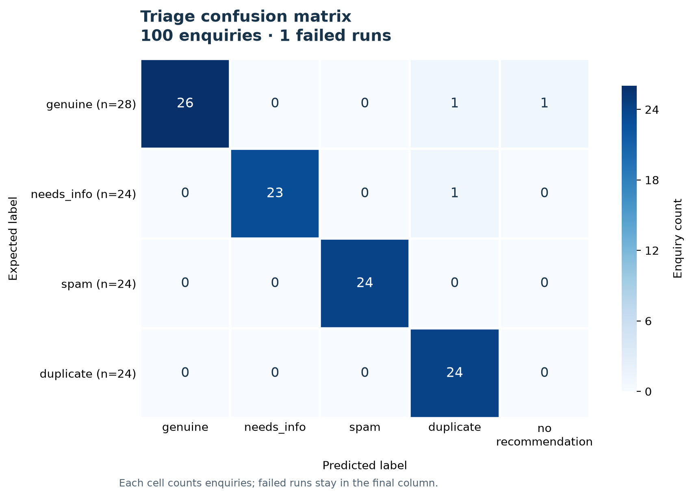
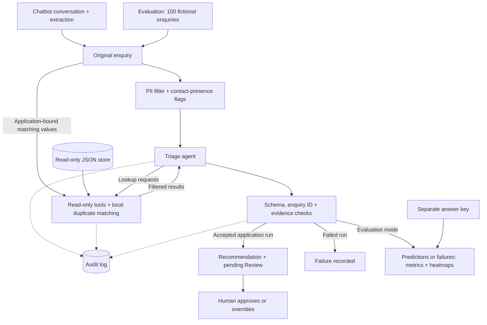

# Rental chatbot with human-reviewed triage

A Python prototype for collecting rental enquiries, extracting structured fields,
and proposing classifications with evidence, audit records and a human decision.
The examples use fictional people and inventory in the Montréal region and Copenhagen,
with English, French and Danish messages. This classifies enquiries, not tenant eligibility.

## Evaluation results

Live model calls on synthetic data. **Answer-key review: pending; review date to be confirmed.**

| Evaluation | Archived runs | Correct across runs | Per-run accuracy range | Failed cases |
|---|---|---:|---:|---:|
| [Agent triage](results/official_runs/agent_triage/) | `eval_4`–`eval_9`: 100 enquiries each | 580/600 (96.7%) | 95–98% | 8/600 |
| [Chatbot final extraction](results/official_runs/chatbot/) | `eval_10`–`eval_15`: 25 conversations each | 147/150 (98.0%) | 92–100% | 0/150 |

These reports are dated 2026-10-31 and record `claude-haiku-5-5`, with output ceilings
of 2,048 tokens for triage and 1,024 for extraction. Failures remain in the accuracy
denominator. Repeated runs use the same synthetic cases; these totals are predictions
on 100 enquiries and 25 conversations, respectively, not additional unique examples.

See the [results index](results/README.md) for every run's scores, reports, cost
estimates and triage heatmaps. Earlier development runs `eval_1`–`eval_3` are
preserved in [past_runs](results/past_runs/) and used a 1,024-token triage ceiling.

The full write-up — system design, trade-offs and evaluation — is in
[docs/Rental_Chatbot_and_Agent_Triage.pdf](docs/Rental_Chatbot_and_Agent_Triage.pdf).



*Triage `eval_9`: 97/100 correct labels, one evidence-check failure and 24/24 exact
duplicate outcomes. See its [report](results/official_runs/agent_triage/eval_9/report.txt).*

## Workflow



`main.py` runs conversation, extraction and guarded triage, then opens the human
review queue in the same session. Use `--queue-only` to defer human review and run
the review command separately. Evaluation uses the
same guarded triage path and bypasses pending reviews to score original outputs.

## Governance controls

| Control | Implementation | Boundary |
|---|---|---|
| Read-only model tools | Lookup allowlists and a read-only store; application code saves runtime state outside the tool loop. | No model-controlled writer is registered. |
| Triage data minimization | Filtered enquiry fields, redacted messages, presence flags and privately bound duplicate inputs; contact arguments omitted from tool-call logs. | The chatbot collects original details; pattern-based redaction has known misses and false positives. |
| Output validation | Pydantic schema, enquiry-ID checks and source-scoped evidence matching. | Text occurrence does not establish correct reasoning or a genuine duplicate relationship. |
| Human decision record | Pending reviews link enquiry and run; approve/override validators and write-once decided reviews. | Single-reviewer workflow; no concurrent-write locking. |
| Audit trail | Run IDs link model/tool events, token usage, guards and outcomes. | Human decisions are saved as Review files, not their own Event type. |
| File integrity | Same-directory atomic replacement; pending review saved after both bodies. | Atomic per file, not a transaction across the three files. |
| Evaluation accountability | Separate answer key, per-class counts, explicit failures and duplicate-target scoring. | Synthetic cases informed development; answer-key review: pending; review date to be confirmed. |

Reviewers see the original enquiry and a note explaining redacted evidence quotes.
Unknown names, short/lowercase partial names and unsupported contact formats can remain;
grouped numeric lists can be redacted as phones. Evidence matching tolerates supported
Unicode, whitespace and quote variants plus initial-letter case in message quotes.
Use fictional data: saved original enquiries contain contact details, and Git ignore
does not encrypt files or provide access control.

## Setup

Developed with Python 3.12. From the repository root, in a macOS/Linux shell:

```bash
python3.12 -m venv .venv
source .venv/bin/activate
python -m pip install -r requirements.txt -r requirements-dev.txt
cp .env.example .env
```

Set `ANTHROPIC_API_KEY` in `.env`. Chatbot and live evaluations call the external model;
automated tests use fake clients and need no API key. Linux may require `python3-venv`.

## Chatbot, triage and review

```bash
python main.py
```

Enter fictional rental messages and type `done` to extract and save an enquiry,
automatically run triage, and open its recommendation for human review. The
recommendation remains pending until a reviewer approves or overrides it.
If triage fails, the enquiry stays saved and the command reports the failure;
no pending review is created for a rejected model output.

The review queue includes all pending reviews from earlier sessions too.
To defer human review until later:

```bash
python main.py --queue-only
```

A separate final-extraction benchmark contains 25 conversations. Its six archived
live runs are summarized above; answer-key review remains pending.

The triage API is `triage_enquiry(enquiry, client, data_store, max_tokens=2048)`.
It returns a `TriageResult` with the generated `run_id` and validated recommendation,
and normally saves a pending review. `output_dir=None` skips those saves, not audit logging.

For rental requests after ruling out spam and supported duplicates, **genuine** means
name AND (email OR phone); **needs_info** means a missing name or both contacts missing.
Blank structured fields count as absent. Listing, budget, currency and move-in date
are optional. Shared contacts or a matching listing/date alone do not prove duplication.

```bash
python -m core.manual_review
```

Enter a reviewer name; use `a` to approve, `o` to override, `s` to skip or `q` to quit.
Overrides require an explanation. Runtime bodies are in `output/enquiries/` and
`output/recommendations/`; reviews are `output/reviews/ENQUIRY_ID/RUN_ID.json`.
Triage audits are `audit/RUN_ID.jsonl`. Runtime execution leaves `data/` unchanged.

## Evaluate and plot

The [100 enquiries](data/unit_enquiries.json) have a separate [answer key](data/enquiry_recommendation_ground_truth.json).
Distribution: **28 genuine, 24 needs_info, 24 spam, 24 duplicate**. The original 47 inputs
are retained alongside 53 challenge cases. Review status is stated above; structural
Python checks do not establish that every draft label is semantically correct.

```bash
python -m eval.agent_triage.run_eval --max-tokens 2048
python -m eval.agent_triage.run_eval --ids ENQ-001,ENQ-004,ENQ-011,ENQ-012 --max-tokens 2048
```

Each attempt gets a unique `output/eval/agent_triage/EVALUATION_ID/` folder with predictions,
metrics, a text report, selected answers and audit logs. Truncation remains a failed
case with no automatic retry. `metrics.json` records the output-token ceiling.
Evaluation creates no pending reviews; duplicate labels and targets are scored separately.

Replace `EVALUATION_ID` with the folder printed by the runner:

```bash
python -m eval.agent_triage.plot output/eval/agent_triage/EVALUATION_ID/metrics.json
python -m eval.agent_triage.plot output/eval/agent_triage/EVALUATION_ID/metrics.json --normalize
```

Plots read saved results and make no model calls. PNG is the default; `--output matrix.pdf`
or `--output matrix.svg` exports a vector figure. PR/ROC curves require prediction scores
that the current outputs do not supply.

The committed archives use this layout:

```text
results/
├── README.md                         # Per-run scores, links and provenance
├── past_runs/eval_1..eval_3/           # Earlier triage reports and heatmaps
└── official_runs/
    ├── agent_triage/eval_4..eval_9/    # Reports, cost reports and heatmaps
    └── chatbot/eval_10..eval_15/       # Extraction reports and cost reports
```

New evaluations still write to `output/eval/`; archiving selected artifacts under
`results/` is a separate step. The archives contain readable reports and figures,
with triage audit logs also included for `eval_8`. Full machine-readable outputs
are not included in these archives.

For future repeated full runs, freeze the reviewed key, code, model and settings.
Preserve all results and report per-run values, mean, range and failures. See the
[evaluation guide](eval/eval_readme.txt) for the procedure and
[dataset notes](data/seed_data_README.txt) for case design.

## Chatbot extraction evaluation

The 25 [fixed conversations](eval/chatbot/data/conversations.json) have a separate
[final-result answer key](eval/chatbot/data/ground_truth.json). They include
follow-ups, corrections, declined fields,
mixed languages and unrelated details, with up to five user turns before `done`.
Only the final fields and `declined_fields` are scored across all 25 cases.
Reports also check two pairs with the same facts expressed differently.

```bash
python -m eval.chatbot.run_eval
python -m eval.chatbot.run_eval --limit 2
```

This makes one extraction call per transcript, with fixed assistant replies and no
per-turn assertions. Reports go to `output/eval/chatbot/EVALUATION_ID/`.
**Answer-key review: pending; review date to be confirmed.**
The archived `eval_10`–`eval_15` reports cover all 25 conversations. They measure
final extraction from fixed transcripts; they do not score live follow-up questions
or the complete chat-to-human-review workflow.
See the [chatbot guide](eval/chatbot/eval_readme.txt).

## Evaluation cost

Evaluations include token totals, an estimated USD cost and an average per
case in `metrics.json` and `report.txt`, plus `cost.json` and `cost_report.txt`.
Estimates include tool turns and failed outputs and save the pricing source/date.
They use standard API rates, before discounts and taxes.

Recover the cost of a completed triage run, including one started before this change:

```bash
python -m eval.cost output/eval/agent_triage/EVALUATION_ID
```

This reads saved logs and writes only the cost sidecars; it makes no API calls.
Let an evaluation finish first. See the [evaluation guide](eval/eval_readme.txt)
for missing-usage limits and the older output paths.

## Checks

```bash
python -m pytest
ruff check .
```

Tests cover models, tools, privacy, evidence, saves, reviews, scoring and plotting
with fake clients. They are separate from live model evaluations.

See [key decisions](DECISIONS.md) for the main design choices and trade-offs.
