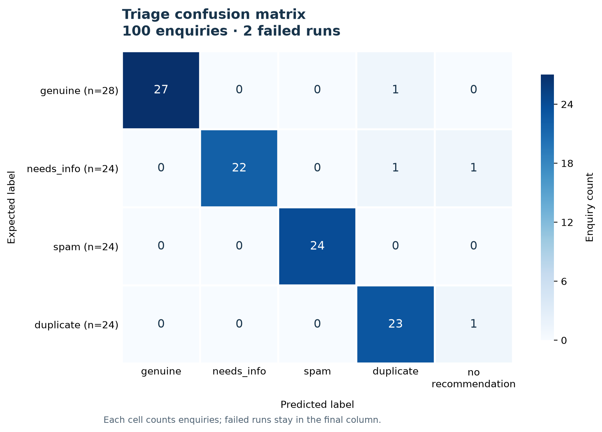
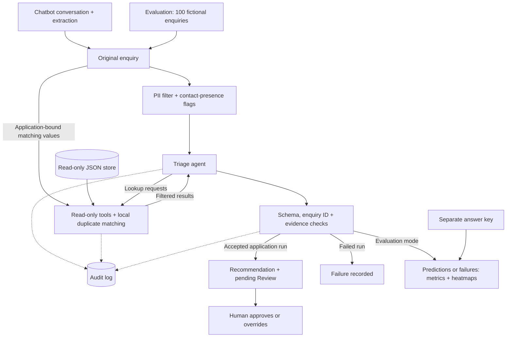

# Rental chatbot with human-reviewed triage

A Python prototype for collecting rental enquiries, extracting structured fields,
and proposing classifications with evidence, audit records and a human decision.
The examples use fictional people and inventory in the Montréal region and Copenhagen,
with English, French and Danish messages. This classifies enquiries, not tenant eligibility.

## Development results

Live model calls on synthetic data. **Full author review of the answer key is pending.**

| Run | Correct labels | Failed runs | Exact duplicate targets |
|---|---:|---:|---:|
| [47-case pilot](results/eval_1/report.txt) | 46/47 (97.9%) | 1/47 | 8/8 |
| [100-case run 1](results/eval_2/report.txt) | 99/100 (99.0%) | 0/100 | 24/24 |
| [100-case run 2](results/eval_3/report.txt) | 96/100 (96.0%) | 2/100 | 23/24 |

Failures remain in the accuracy denominator. These development runs used a 1,024-token
output ceiling; the current default is 2,048. The pilot also predates the initial-letter
quote-matching adjustment. See [archive provenance](results/README.md) for settings and
original run IDs. These are not final repeatability results or real-user measurements.



*Latest archived run: 100 enquiries, 96 correct labels and two truncated outputs.
Two accepted false duplicate labels involved candidates matching only listing and date.*

## Workflow



`main.py` runs conversation and extraction. The application separately calls
`triage_enquiry`; human review is another terminal operation. Evaluation uses the
same guarded triage path and bypasses pending reviews to score original outputs.

## Governance controls

| Control | Implementation | Boundary |
|---|---|---|
| Read-only model tools | Lookup allowlists and a read-only store; application code saves runtime state outside the tool loop. | No model-controlled writer is registered. |
| Triage data minimization | Filtered enquiry fields, redacted messages, presence flags and privately bound duplicate inputs; contact arguments omitted from tool-call logs. | The chatbot collects original details; pattern-based redaction has known misses and false positives. |
| Output validation | Pydantic schema, enquiry-ID checks and source-scoped evidence matching. | Text occurrence does not establish correct reasoning or a genuine duplicate relationship. |
| Human decision record | Pending reviews link enquiry and run; approve/override validators and write-once decided reviews. | Single-reviewer workflow; no concurrent-write locking. |
| Audit trail | Run IDs link model/tool events, token usage, guards and outcomes. | Human decisions are saved as Review files, not their own Event type. |
| File integrity | Same-directory atomic replacement; pending review saved after both bodies. | Atomic per file, not a transaction across the three files. |
| Evaluation accountability | Separate answer key, per-class counts, explicit failures and duplicate-target scoring. | Synthetic cases informed development; answer-key review is pending. |

Reviewers see the original enquiry and a note explaining redacted evidence quotes.
Unknown names, short/lowercase partial names and unsupported contact formats can remain;
grouped numeric lists can be redacted as phones. Evidence matching tolerates supported
Unicode, whitespace and quote variants plus initial-letter case in message quotes.
Use fictional data: saved original enquiries contain contact details, and Git ignore
does not encrypt files or provide access control.

## Setup

Developed with Python 3.12. From the repository root, in a macOS/Linux shell:

```bash
python3.12 -m venv .venv
source .venv/bin/activate
python -m pip install -r requirements.txt -r requirements-dev.txt
cp .env.example .env
```

Set `ANTHROPIC_API_KEY` in `.env`. Chatbot and live evaluations call the external model;
automated tests use fake clients and need no API key. Linux may require `python3-venv`.

## Chatbot, triage and review

```bash
python main.py
```

Enter fictional rental messages and type `done` to extract and save an enquiry.
A live chatbot-extraction benchmark is planned; its accuracy has not been measured.

The triage API is `triage_enquiry(enquiry, client, data_store, max_tokens=2048)`.
It returns a `TriageResult` with the generated `run_id` and validated recommendation,
and normally saves a pending review. `output_dir=None` skips those saves, not audit logging.

For rental requests after ruling out spam and supported duplicates, **genuine** means
name AND (email OR phone); **needs_info** means a missing name or both contacts missing.
Blank structured fields count as absent. Listing, budget, currency and move-in date
are optional. Shared contacts or a matching listing/date alone do not prove duplication.

```bash
python -m core.manual_review
```

Enter a reviewer name; use `a` to approve, `o` to override, `s` to skip or `q` to quit.
Overrides require an explanation. Runtime bodies are in `output/enquiries/` and
`output/recommendations/`; reviews are `output/reviews/ENQUIRY_ID/RUN_ID.json`.
Triage audits are `audit/RUN_ID.jsonl`. Runtime execution leaves `data/` unchanged.

## Evaluate and plot

The [100 enquiries](data/unit_enquiries.json) have a separate [answer key](data/enquiry_recommendation_ground_truth.json).
Distribution: **28 genuine, 24 needs_info, 24 spam, 24 duplicate**. The original 47 inputs
are retained alongside 53 challenge cases. Review status is stated above; structural
Python checks do not establish that every draft label is semantically correct.

```bash
python -m eval.run_eval --max-tokens 2048
python -m eval.run_eval --ids ENQ-001,ENQ-004,ENQ-011,ENQ-012 --max-tokens 2048
```

Each attempt gets a unique `output/eval/EVALUATION_ID/` folder with predictions,
metrics, a text report, selected answers and audit logs. Truncation remains a failed
case with no automatic retry. `metrics.json` records the output-token ceiling.
Evaluation creates no pending reviews; duplicate labels and targets are scored separately.

Replace `EVALUATION_ID` with the folder printed by the runner:

```bash
python -m eval.plot output/eval/EVALUATION_ID/metrics.json
python -m eval.plot output/eval/EVALUATION_ID/metrics.json --normalize
```

Plots read saved results and make no model calls. PNG is the default; `--output matrix.pdf`
or `--output matrix.svg` exports a vector figure. PR/ROC curves require prediction scores
that the current outputs do not supply.

For 3–5 repeated full runs, freeze the reviewed key, code, model and settings. Preserve
all results and report per-run values, mean, range and failures. These are repeated
predictions on 100 known cases. See the [evaluation guide](eval/eval_readme.txt) for the
full procedure and [dataset notes](data/seed_data_README.txt) for case design.

## Checks

```bash
python -m pytest
ruff check .
```

Tests cover models, tools, privacy, evidence, saves, reviews, scoring and plotting
with fake clients. They are separate from live model evaluations.

See [key decisions](DECISIONS.md) for the main design choices and trade-offs.
